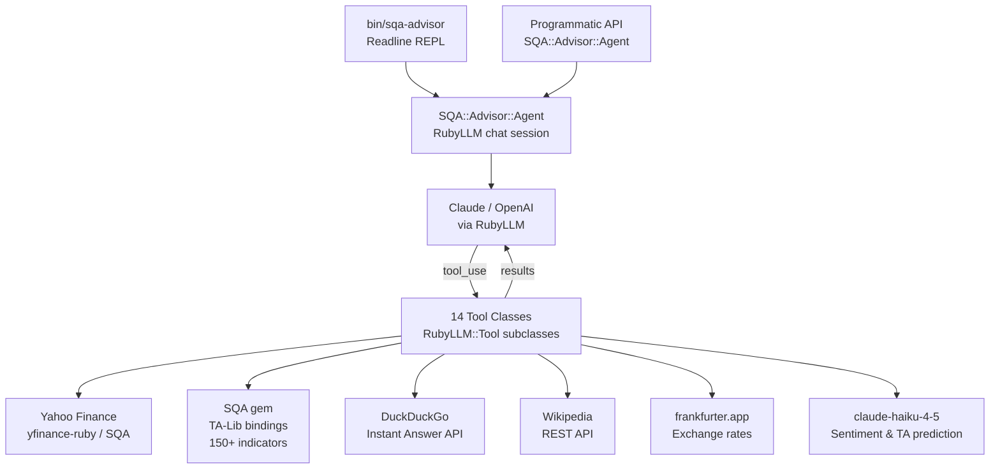

# Architecture

## Overview

SQA Advisor is structured as a thin orchestration layer that connects three external systems — an LLM, a technical analysis library, and a financial data API — through a uniform tool interface.



---

## Key components

### Agent (`lib/sqa/advisor/agent.rb`)

`SQA::Advisor::Agent` owns a single `RubyLLM` chat session for the lifetime of a conversation. It:

- Configures API keys from the environment on initialization
- Prepends the system prompt (from `Prompts::SYSTEM_PROMPT`) plus a live UTC timestamp on every new chat
- Binds all 14 tool classes via `.with_tools(*TOOLS)`
- Exposes `ask(input)` (appends `HUMAN_PREFIX` before forwarding) and `reset` (rebuilds the chat)

The `TOOLS` array in `Agent` is the single registration point — adding a class here makes it available to the LLM.

### Prompts (`lib/sqa/advisor/prompts.rb`)

Two constants:

- `SYSTEM_PROMPT` — comprehensive persona and tool descriptions injected at chat creation. Instructs the LLM to produce 9-section Markdown reports with tables, K/M/B/T monetary scale, and a Buy/Hold/Sell recommendation.
- `HUMAN_PREFIX` — prepended to every user message. Instructs the LLM to think step-by-step, verify with tools before concluding, and format output in Markdown.

### Tools (`lib/sqa/advisor/tools/`)

Each tool is a `RubyLLM::Tool` subclass with three elements:

```ruby
class MyTool < RubyLLM::Tool
  description "..."       # visible to the LLM for tool selection
  param :symbol, desc: "..."
  param :range, desc: "...", required: false

  def execute(symbol:, range: "6mo")
    # fetch / compute
    JSON.generate({ ... })
  end
end
```

Tools are autoloaded via a Zeitwerk glob in `lib/sqa/advisor.rb`. Only the `TOOLS` array entry in `agent.rb` is manual.

### CLI (`bin/sqa-advisor`)

A standalone Readline REPL with no application state beyond the `Agent` instance. Handles `reset`, `exit`/`quit`/`bye`, Ctrl+D, and Ctrl+C gracefully. Validates that at least one API key is present before starting.

---

## Data flow

A typical full-analysis request goes through these steps:

```
User input
  → Agent#ask (prepends HUMAN_PREFIX)
    → RubyLLM sends to Claude
      → Claude emits tool_use blocks (6–9 tools for a full analysis)
        → Each tool fetches / computes independently
          → Results returned as tool_result blocks
            → Claude synthesises into Markdown report
              → Agent returns RubyLLM::Message
                → CLI prints .content
```

For `StockNewsSentiment` and `StockTechnicalAnalysis`, a secondary Haiku model call is made from within the tool's `execute` method — entirely transparent to the outer Claude session.

---

## Tool categories

| Category | Tools | External dependency |
|----------|-------|---------------------|
| Fundamental | StockPrice, StockInfo, IncomeStatement, BalanceSheet, CashFlow, StockDividends, StockRecommendations | Yahoo Finance via SQA gem |
| Fundamental + AI | StockNewsSentiment | Yahoo Finance + claude-haiku-4-5 |
| Technical + AI | StockTechnicalAnalysis | Yahoo Finance + SQA/TA-Lib + claude-haiku-4-5 |
| Utility | CurrencyConverter | frankfurter.app |
| Utility | Calculator, DateTool | Built-in (no network) |
| Utility | Wikipedia | Wikipedia REST API |
| Utility | WebSearch | DuckDuckGo Instant Answer API |

---

## Autoloading

`lib/sqa/advisor.rb` sets up Zeitwerk:

```ruby
loader = Zeitwerk::Loader.for_gem
loader.setup
```

All files under `lib/sqa/advisor/` are autoloaded. The `SQA` top-level constant is defined in the `sqa` gem (local path dependency in `Gemfile`); this gem adds the `SQA::Advisor` namespace on top of it.

---

## Secondary LLM calls

Two tools make their own LLM calls independently of the main conversation:

**StockNewsSentiment** — fetches news headlines from Yahoo Finance, then calls `claude-haiku-4-5-20251001` to classify each headline as `positive`, `neutral`, or `negative`. Falls back to `neutral` for all headlines if the classification call fails.

**StockTechnicalAnalysis** — computes all TA-Lib indicators, then calls `claude-haiku-4-5-20251001` to synthesise a short-term (5–10 trading day) directional prediction with direction, confidence, key signals, and a one-sentence reasoning summary.

These secondary calls use Haiku specifically for cost and latency — they are classification/synthesis tasks with bounded output, not multi-turn conversations.
