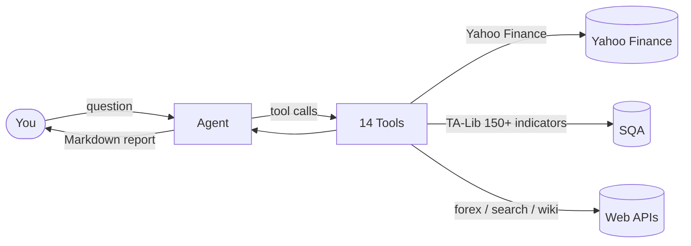

# SQA Advisor

**SQA Advisor** is an AI-powered investment analyst that combines Claude (via [RubyLLM](https://github.com/crmne/ruby_llm)) with the [SQA](https://github.com/MadBomber/sqa) technical analysis library and live Yahoo Finance data. Ask questions about any stock in plain English and receive structured, Markdown-formatted investment reports.

```
You: analyze AAPL
You: compare MSFT and GOOGL on cash flow and margins
You: what is NVDA's RSI and is it overbought?
You: give me a full buy/hold/sell on TSLA
```

## How it works

The agent receives your question, selects from 14 financial tools, fetches live data, and synthesizes a report — all in one turn.



## Report structure

Every analysis follows a 9-section format:

| # | Section |
|---|---------|
| 1 | Company Overview — business, sector, industry, size |
| 2 | Current Market Position — price, valuation, market cap |
| 3 | Financial Health — income trends, balance sheet, cash flow |
| 4 | Dividend Analysis *(if applicable)* |
| 5 | Analyst Sentiment — consensus, target prices, rating changes |
| 6 | News & Market Sentiment — recent headlines |
| 7 | Technical Analysis — indicators, regime, strategy signals |
| 8 | Risk Factors & Opportunities |
| 9 | Investment Recommendation — Buy / Hold / Sell with rationale |

## Key features

- **14 financial tools** covering fundamentals, technicals, sentiment, and utilities
- **150+ technical indicators** via SQA's TA-Lib bindings
- **Live data** from Yahoo Finance (no API key required)
- **Multi-provider LLM** — Claude by default, switchable to OpenAI
- **Conversational REPL** with readline history and `reset` command

## Quick example

```bash
gem install sqa-advisor
export ANTHROPIC_API_KEY=sk-ant-...
sqa-advisor
```

```
You: is AMD a buy right now?
```

The advisor fetches price, fundamentals, technical indicators, analyst ratings, and recent news, then returns a complete investment report — typically in under 30 seconds.
